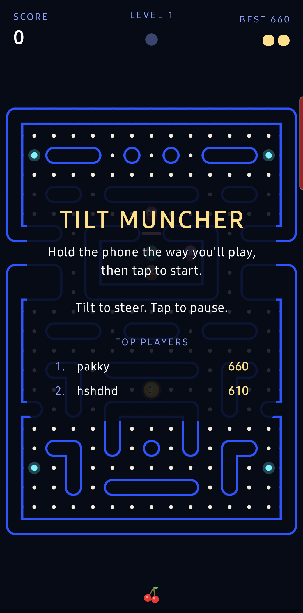
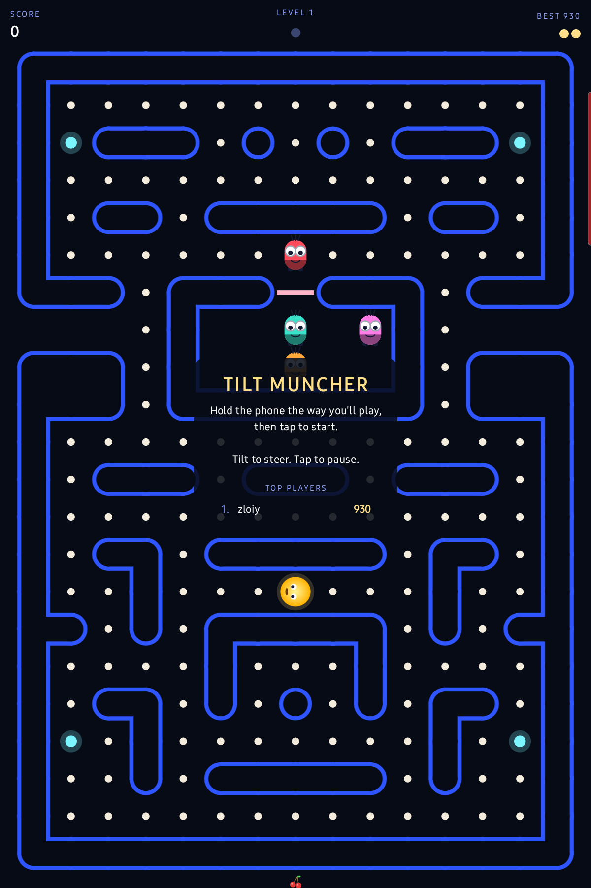

# Tilt Muncher

An original tilt-controlled maze-chase game for Android, written in Kotlin with Jetpack Compose.

<p>


</p>

Steer the Muncher through the maze by tilting the phone. Collect every spark to clear the level while four Sentinels, each with its own personality, hunt you down. Grab a Surge to turn the tables for a few seconds and send them back to their nest.

## Features

- Tilt steering with on-the-spot calibration (hold the phone how you like, tap to start), swipe fallback
- Classic maze-chase rules: per-level speed tables, scatter/chase cycles, four chase personalities, dot-counter house release, frightened timing with flashing, eyes running home, cornering, bonus fruit, extra life
- Original 15x22 maze with rounded hollow walls, a gated nest that opens for Sentinels, and a side tunnel
- Chiptune sound effects synthesized by `tools/gen_sounds.py` (chomp, siren that rises as dots run out, surge warble, catches, death, jingles)
- Local top-10 leaderboard with name entry
- Haptics on catches; keeps the screen on; portrait only

## Controls

- **Tilt** the phone to steer. On the title screen, hold the phone the way you'll play and tap: that angle becomes neutral.
- **Tap** to pause. Tapping again resumes and recalibrates to how you're holding the phone now.
- **Swipe** works as a fallback on devices without a usable motion sensor.

## Building

Requires JDK 17+ and an Android SDK with platform `android-37.0` and build-tools 37. Regenerate the sound clips with `python3 tools/gen_sounds.py` after editing them.

```sh
./gradlew assembleDebug
# -> app/build/outputs/apk/debug/app-debug.apk
```

Install over wireless debugging:

```sh
adb pair <phone-ip>:<pairing-port> <code>     # once
adb connect <phone-ip>:<connect-port>
adb install -r app/build/outputs/apk/debug/app-debug.apk
```

`tools/find-adb-port.py` scans a phone for its (randomised) wireless-debugging connect port.

## Layout

- `app/src/main/kotlin/com/megapro/tiltmuncher/game/` — maze layout, movement, Sentinel AI, level tables, scoring (no Android types)
- `app/src/main/kotlin/com/megapro/tiltmuncher/ui/` — Compose rendering, HUD, overlays, dialogs, input
- `app/src/main/kotlin/com/megapro/tiltmuncher/audio/` — SoundPool wrapper; `data/` — leaderboard storage
- `MainActivity.kt` — sensor handling, haptics, screen setup

Minimum Android 8.0 (API 26). Targets API 37.
